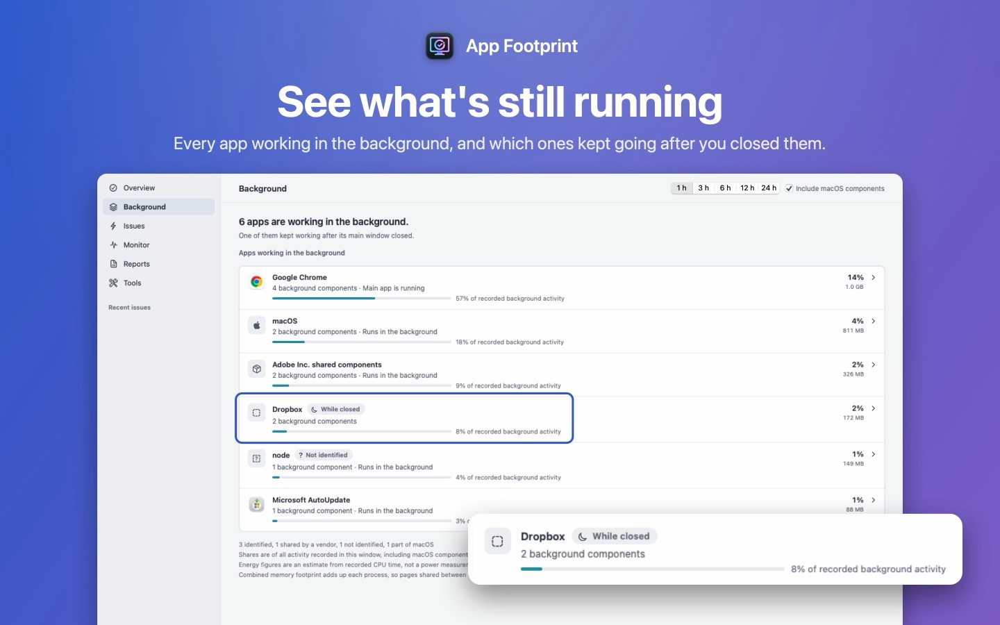

English · [简体中文](zh-Hans/) · [繁體中文](zh-Hant/) · [日本語](ja/)

# App Footprint

**See what your apps leave behind.** App Footprint is a Mac app that puts background helpers, updaters and sync services back under the app they belong to, shows what each app is using, and keeps a local record so you can look back when your Mac slowed down.

[Download App Footprint on the Mac App Store](https://apps.apple.com/app/app-footprint/id6809305281). Free to download, macOS 14 or later, Apple silicon and Intel. English, Simplified Chinese, Traditional Chinese and Japanese.

*Sample screenshot: the apps are real, the numbers are made up for illustration.*

## What it does

- **Background activity, by app.** The Background page lists the apps that still have something running, such as Chrome, Dropbox or Adobe, with how many components each one has and which kept working after you closed the main window.
- **What each app is using.** Current CPU, the combined memory of the app's processes, and an energy estimate for the last 1 to 24 hours. The estimate comes from recorded CPU time; it is not a power measurement.
- **When your Mac slows down.** App Footprint keeps a record of recent activity, so you can look back at which apps were busy around the time your Mac felt slow, ran hot or lost battery faster than usual. It lists likely causes with the evidence for and against each, suggests a low-risk step, and checks afterwards whether things improved.
- **Stays on your Mac.** No account, no sign-in, no analytics, and the app has no network access. A report only leaves your Mac if you export and share it, and personal details are hidden by default.

## Questions

### Why is an app still using CPU after I closed its window?

On a Mac, closing the last window often leaves the app running until you quit it. Many apps also run separate helper processes, such as updaters, sync services and browser helpers, which can keep working after the main app is gone. Activity Monitor's CPU and Memory tabs list these processes one by one (its Energy tab groups some of them under their app); App Footprint groups the ones it can identify under the app they belong to and keeps a record.

### Does App Footprint upload my data?

No. It has no account and no network access. Its history is stored only on your Mac, and a report leaves the Mac only if you export it yourself.

### Does it need special permissions?

No. It does not ask for Full Disk Access or Accessibility. If you use Storage and pick your home folder, macOS may ask whether App Footprint can open folders such as Music or Photos; you can allow or deny, and denied folders are counted as unreadable.

### How is it different from Activity Monitor?

Activity Monitor shows what is running right now; its Energy tab groups some processes under their app. App Footprint names the app each process belongs to when it can, keeps a history so you can look back after a slowdown, and walks through possible causes with the evidence for each.

### Is it a cleaner or an antivirus?

No. It does not delete caches, does not scan for malware and does not judge whether an app is safe. In Storage, only items you tick yourself are moved to the Trash.

### How much does it cost?

The app is free to download. Yearly access (USD 1.99 in the United States) starts with a 14-day free trial for eligible subscribers; Lifetime (USD 4.99) is a one-time purchase that includes future updates. Prices in other regions are set by the App Store. Without a plan, monitoring, the Background page, storage review and saved evidence keep working.

### Does it show temperatures and fan speeds?

The App Store version cannot read them inside its sandbox. The optional, free App Footprint Sensors app adds temperatures, fan speeds and per-process disk activity (see Support below).

## Guides

- [How to see what's running in the background on your Mac](guides/see-background-apps-mac/)
- [What are the Helper processes in Activity Monitor?](guides/helper-processes-activity-monitor/)
- [Mac fan running with no apps open? How to find what's using the CPU](guides/mac-fan-running-no-apps/)

## Support

- **Get help:** [open an issue](https://github.com/SioYooo/app-footprint/issues). Issues are public, so do not paste personal data. If you attach a report, export it from the app with redaction on and check the preview first.
- **Requirements:** macOS 14 or later.
- **App Footprint Sensors (optional, free):** adds temperatures, fan speeds and per-process disk I/O, which the App Store app cannot read inside its sandbox. [Download 0.1.0](https://github.com/SioYooo/app-footprint/releases/tag/sensors-0.1.0) (signed with Developer ID and notarized by Apple). Unzip, move it to Applications and open it. It only reads, and makes no network connections.
- **Purchases:** the yearly plan starts with a free two-week trial offered by Apple; a one-time Lifetime purchase is also available. On another Mac, use **Restore Purchases** in Settings. Subscriptions are managed in your Apple account.
- **Privacy:** [privacy policy](privacy/en).
