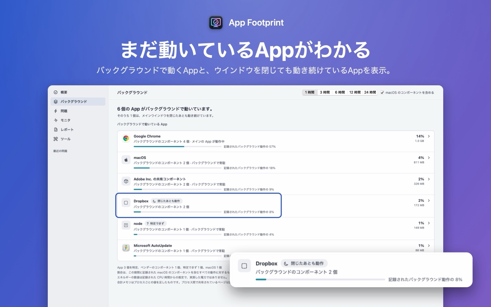

[English](../) · [简体中文](../zh-Hans/) · [繁體中文](../zh-Hant/) · 日本語

# App Footprint

**Appを閉じたあと、何が残っているかを確認。** App Footprintは、バックグラウンドのHelperやアップデータ、同期サービスをそれぞれのAppの下にまとめ、Appごとの使用状況を表示するMac用Appです。最近の記録をMacの中に残すので、動作が遅くなったときに、どのAppが忙しかったかをさかのぼって確認できます。

[Mac App StoreでApp Footprintをダウンロード](https://apps.apple.com/app/app-footprint/id6809305281)。ダウンロード無料。macOS 14以降、Appleシリコン搭載MacとIntel搭載Macに対応。日本語、英語、簡体字中国語、繁体字中国語で使えます。

## できること

- **Appごとに見るバックグラウンド。**「バックグラウンド」ページには、まだ何かが動いているAppが並びます。Chrome、Dropbox、Adobeなど、Appごとに動いている構成要素の数と、メインウインドウを閉じたあとも動き続けているものがわかります。
- **それぞれのAppが使っているもの。** 現在のCPU、全プロセスを合計したメモリ使用量、過去1〜24時間のエネルギー推定。エネルギーは記録したCPU時間からの推定で、実測の消費電力ではありません。
- **Macが急に遅くなったとき。** 最近の状態を記録しているので、動作が重い、本体が熱い、バッテリーの減りが早いといったときに、その少し前にどのAppが忙しかったかを確認できます。考えられる原因を根拠と反証とあわせて示し、リスクの低い手順をひとつ提案して、実行後に改善したかを確かめます。
- **データはこのMacの中だけに。** アカウントもサインインも不要で、利用状況の収集もしません。App自体にネットワークへのアクセス権がありません。レポートは自分で書き出して共有したときだけMacの外に出ます。書き出すときは個人情報が既定で隠されます。

## よくある質問

### ウインドウを閉じたのに、AppがCPUを使い続けるのはなぜですか？

Macでは、最後のウインドウを閉じてもAppは終了せず、⌘Qで終了するまで動いていることがよくあります。また、多くのAppはアップデータや同期サービス、ブラウザの補助プロセスなどのHelperを別に動かしていて、メインのAppを終了したあとも動き続けることがあります。アクティビティモニタはこれらをプロセスごとに一覧するだけですが、App Footprintは識別できたものをそれぞれのAppの下にまとめます。

### データを送信しますか？

しません。アカウントはなく、ネットワークへのアクセス権もありません。記録はこのMacの中だけに保存され、レポートは自分で書き出したときだけMacの外に出ます。

### 特別なアクセス権は必要ですか？

必要ありません。フルディスクアクセスやアクセシビリティの許可は求めません。「ストレージ」でホームフォルダを選ぶと、「ミュージック」や「写真」などのフォルダへのアクセスをmacOSが確認することがあります。許可しても拒否してもかまいません。拒否したフォルダは読み取れないものとして数えます。

### アクティビティモニタとの違いは？

アクティビティモニタはプロセスを一覧します。App Footprintは、できる限り各プロセスがどのAppのものかを示し、履歴を残して遅くなったあとでも振り返れるようにし、考えられる原因を根拠とともに順に示します。

### クリーナーやウイルス対策ソフトですか？

どちらでもありません。キャッシュの削除もマルウェアのスキャンもせず、Appが安全かどうかも判定しません。「ストレージ」では、自分でチェックした項目だけがゴミ箱に移されます。

### 料金は？

ダウンロードは無料です。「年間サブスクリプション」は対象となる方に14日間の無料トライアルがあり、「買い切り」は一度の支払いで今後のアップデートも含まれます。米国での価格は年間1.99ドルと買い切り4.99ドルで、その他の地域ではApp Storeに表示される価格になります。購入しなくても、モニタ、「バックグラウンド」ページ、ストレージの確認、保存済みの根拠は引き続き使えます。

### 温度やファンの回転数は見られますか？

App Store版はサンドボックスの中ではこれらを読み取れません。無料のApp Footprint Sensorsを追加すると、温度、ファンの回転数、プロセスごとのディスクの読み書きが表示されます（下の「サポート」を参照）。

## サポート

- **サポート：**[Issue を作成](https://github.com/SioYooo/app-footprint/issues)してください。Issue は公開されるため、個人情報は貼り付けないでください。レポートを添付する場合は、App で秘匿処理を有効にして書き出し、プレビューを確認してください。
- **動作環境：**macOS 14 以降。
- **App Footprint Sensors（オプション、無料）：**App Store 版がサンドボックス内で読み取れない温度、ファンの回転数、プロセスごとのディスク読み書きを補います。[0.1.0 をダウンロード](https://github.com/SioYooo/app-footprint/releases/tag/sensors-0.1.0)（Developer ID で署名、Apple の公証済み）。解凍して「アプリケーション」フォルダに移動し、開いてください。読み取り専用で、ネットワークには接続しません。
- **購入：**年間プランには Apple による 2 週間の無料トライアルがあります。一度だけ支払う「買い切り」もあります。別の Mac では、設定の**購入を復元**を使ってください。サブスクリプションは Apple アカウントで管理します。
- **プライバシー：**[プライバシーポリシー](../privacy/ja)。
