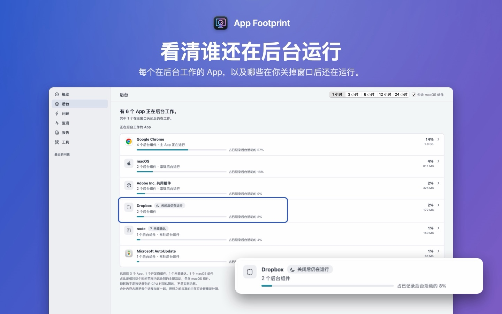

[English](../) · 简体中文 · [繁體中文](../zh-Hant/) · [日本語](../ja/)

# App Footprint

**看看 App 关掉以后还留下了什么。** App Footprint 是一个 Mac App：把后台的 Helper、更新程序和同步服务归到它们所属的 App 下面，显示每个 App 用了多少资源，并在本机保留一段时间的记录，Mac 变慢时可以往回查是谁在忙。

[在 Mac App Store 下载 App Footprint](https://apps.apple.com/app/app-footprint/id6809305281)。免费下载，需要 macOS 14 或更高版本，支持 Apple 芯片和 Intel 芯片的 Mac。界面有简体中文、繁体中文、英文和日文。

*示意图：App 是真实的，数字是为演示编的。*

## 能做什么

- **按 App 看后台。**「后台」页面列出还有东西在运行的 App，比如 Chrome、Dropbox、Adobe：每个 App 有几个组件在跑，哪些在你关掉主窗口后还在工作。
- **每个 App 用了多少。** 当前的 CPU、它所有进程合计的内存，以及过去 1 到 24 小时的能耗估算。能耗是按记录到的 CPU 时间估出来的，不是实测功耗。
- **Mac 突然变慢时。** App Footprint 保留最近一段时间的系统记录。Mac 变慢、发烫或者掉电比平时快的时候，可以往回看那段时间哪些 App 比较忙。它会列出可能的原因，每个原因附上支持和反对的证据，建议一个风险低的步骤，做完再看有没有好转。
- **数据留在这台 Mac 上。** 不用注册，不用登录，不做使用统计，App 本身没有联网权限。报告只有在你自己导出、发给别人时才会离开这台电脑，导出时默认隐藏个人信息。

## 常见问题

### 为什么 App 关掉窗口以后还在占 CPU？

在 Mac 上，关掉最后一个窗口往往不等于退出 App，按 ⌘Q 才会退出。另外，很多 App 会单独运行 Helper 进程，比如更新程序、同步服务、浏览器的辅助进程，主 App 退出后它们还可能继续工作。「活动监视器」的「CPU」和「内存」标签页把这些进程一个个列出来（「能耗」标签页会把一部分归到 App 下面），App Footprint 会把能识别的归到所属的 App 下面，并保留记录。

### App Footprint 会上传我的数据吗？

不会。它没有账户，也没有联网权限。记录只存在这台 Mac 上；报告只有你自己导出时才会离开这台电脑。

### 需要给它特殊权限吗？

不需要。它不申请「完全磁盘访问权限」，也不申请「辅助功能」权限。如果你在「储存空间」里选了个人文件夹，macOS 可能会问是否允许 App Footprint 访问「音乐」「照片」等文件夹，允许或拒绝都可以，拒绝的文件夹会记为无法读取。

### 和「活动监视器」有什么不同？

「活动监视器」显示的是此刻在运行的进程，「能耗」标签页会把一部分进程归到 App 下面。App Footprint 尽量说出每个进程属于哪个 App，保留历史记录让你在卡顿之后还能回看，并且把可能的原因和对应的证据一条条列出来。

### 它是清理软件或者杀毒软件吗？

都不是。它不清缓存，不查病毒，也不判断某个 App 是否安全。在「储存空间」里，只有你自己勾选的项目才会移到废纸篓。

### 多少钱？

免费下载。「按年订阅」对符合条件的用户提供 14 天免费试用；「永久买断」一次付款，包含以后的更新。美国区价格是每年 1.99 美元和一次性 4.99 美元，其他地区以 App Store 显示的价格为准。不购买也能继续用监测、「后台」页面、储存空间检查和已保存的证据。

### 能看温度和风扇转速吗？

App Store 版在沙盒里读不到这些数据。可以另外装免费的 App Footprint Sensors，补上温度、风扇转速和每个进程的磁盘读写（见下面的「支持」）。

## 文章

- [怎么看 Mac 后台在运行什么](guides/see-background-apps-mac/)
- [活动监视器里的 Helper 进程是什么](guides/helper-processes-activity-monitor/)
- [Mac 没开 App 风扇也在转？怎么查是谁在占 CPU](guides/mac-fan-running-no-apps/)

## 支持

- **获取帮助：**[提交 Issue](https://github.com/SioYooo/app-footprint/issues)。Issue 是公开的，请勿粘贴个人信息。如需附上报告，请在 App 中开启脱敏后导出，并先检查预览。
- **系统要求：**macOS 14 或更高版本。
- **App Footprint Sensors（可选，免费）：**补上 App Store 版在沙盒里读不到的温度、风扇转速和每个进程的磁盘读写。[下载 0.1.0](https://github.com/SioYooo/app-footprint/releases/tag/sensors-0.1.0)（Developer ID 签名，已通过 Apple 公证）。解压后拖到“应用程序”文件夹并打开。它只读数据，不联网。
- **购买：**年度方案由 Apple 提供两周免费试用；也可选择一次性的「永久买断」。在另一台 Mac 上，请在设置中点按**恢复购买**。订阅在你的 Apple 账户中管理。
- **隐私：**[隐私政策](../privacy/zh-Hans)。
