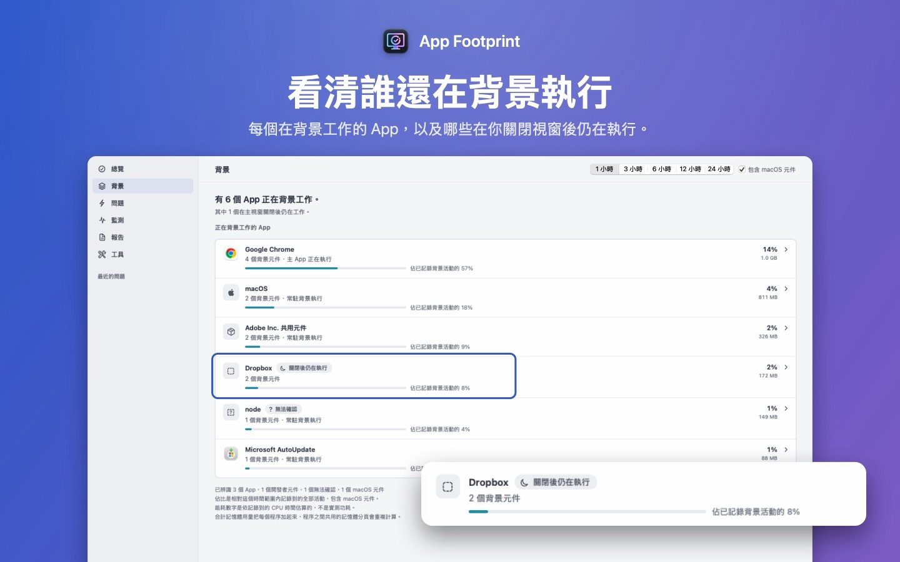

[English](../) · [简体中文](../zh-Hans/) · 繁體中文 · [日本語](../ja/)

# App Footprint

**看看 App 關掉以後還留下了什麼。** App Footprint 是一個 Mac App：把背景的 Helper、更新程式和同步服務歸到所屬的 App 底下，顯示每個 App 用了多少資源，並在本機保留一段時間的紀錄，Mac 變慢時可以回頭查是誰在忙。

[在 Mac App Store 下載 App Footprint](https://apps.apple.com/app/app-footprint/id6809305281)。免費下載，需要 macOS 14 或以上版本，支援 Apple 晶片和 Intel 處理器的 Mac。介面有繁體中文、簡體中文、英文和日文。

## 能做什麼

- **依 App 查看背景。**「背景」頁面列出還有東西在執行的 App，例如 Chrome、Dropbox、Adobe：每個 App 有幾個元件在跑，哪些在你關掉主視窗後還在工作。
- **每個 App 用了多少。** 目前的 CPU、所有程序合計的記憶體，以及過去 1 到 24 小時的耗能估算。耗能是依記錄到的 CPU 時間估算，不是實際量到的功耗。
- **Mac 突然變慢時。** App Footprint 保留最近一段時間的系統紀錄。Mac 變慢、變燙或電池掉得比平常快時，可以回頭看那段時間哪些 App 比較忙。它會列出可能的原因，每個原因附上支持和反對的證據，建議一個風險低的步驟，做完再確認有沒有改善。
- **資料留在這台 Mac 上。** 不用註冊，不用登入，不做使用統計，App 本身沒有連網權限。報告只有在你自己匯出、傳給別人時才會離開這台電腦，匯出時預設隱藏個人資料。

## 常見問題

### 為什麼 App 關掉視窗以後還在佔用 CPU？

在 Mac 上，關掉最後一個視窗往往不等於結束 App，按 ⌘Q 才會結束。另外，很多 App 會另外執行 Helper 程序，例如更新程式、同步服務、瀏覽器的輔助程序，主 App 結束後它們還可能繼續工作。「活動監視器」的「CPU」和「記憶體」標籤頁把這些程序一個個列出來（「能耗」標籤頁會把一部分歸到 App 底下），App Footprint 會把能辨識的歸到所屬的 App 底下，並保留紀錄。

### App Footprint 會上傳我的資料嗎？

不會。它沒有帳號，也沒有連網權限。紀錄只存在這台 Mac 上；報告只有你自己匯出時才會離開這台電腦。

### 需要給它特殊權限嗎？

不需要。它不申請「完整磁碟取用權限」，也不申請「輔助使用」權限。如果你在「儲存空間」裡選了個人檔案夾，macOS 可能會詢問是否允許 App Footprint 存取「音樂」「照片」等檔案夾，允許或拒絕都可以，拒絕的檔案夾會記為無法讀取。

### 和「活動監視器」有什麼不同？

「活動監視器」顯示的是此刻在執行的程序，「能耗」標籤頁會把一部分程序歸到 App 底下。App Footprint 盡量說出每個程序屬於哪個 App，保留歷史紀錄讓你在卡頓之後還能回看，並把可能的原因和對應的證據一條條列出來。

### 它是清理軟體或防毒軟體嗎？

都不是。它不清快取，不掃描惡意軟體，也不判斷某個 App 是否安全。在「儲存空間」裡，只有你自己勾選的項目才會移到垃圾桶。

### 多少錢？

免費下載。「按年訂閱」對符合資格的用戶提供 14 天免費試用；「永久買斷」一次付款，包含之後的更新。美國區價格是每年 1.99 美元和一次性 4.99 美元，其他地區以 App Store 顯示的價格為準。不購買也能繼續使用監測、「背景」頁面、儲存空間檢查和已儲存的證據。

### 能看溫度和風扇轉速嗎？

App Store 版在沙盒裡讀不到這些資料。可以另外安裝免費的 App Footprint Sensors，補上溫度、風扇轉速和每個程序的磁碟讀寫（見下方「支援」）。

## 支援

- **取得協助：**[提交 Issue](https://github.com/SioYooo/app-footprint/issues)。Issue 是公開的，請勿貼上個人資料。如需附上報告，請在 App 中開啟去識別化後匯出，並先檢查預覽。
- **系統需求：**macOS 14 或以上版本。
- **App Footprint Sensors（選用，免費）：**補上 App Store 版在沙盒裡讀不到的溫度、風扇轉速和每個程序的磁碟讀寫。[下載 0.1.0](https://github.com/SioYooo/app-footprint/releases/tag/sensors-0.1.0)（Developer ID 簽署，已通過 Apple 公證）。解壓縮後拖到「應用程式」檔案夾並打開。它只讀取資料，不連網。
- **購買：**年度方案由 Apple 提供兩週免費試用；也可選擇一次性的「永久買斷」。在另一台 Mac 上，請在設定中按一下**回復購買**。訂閱在你的 Apple 帳號中管理。
- **隱私：**[隱私權政策](../privacy/zh-Hant)。
